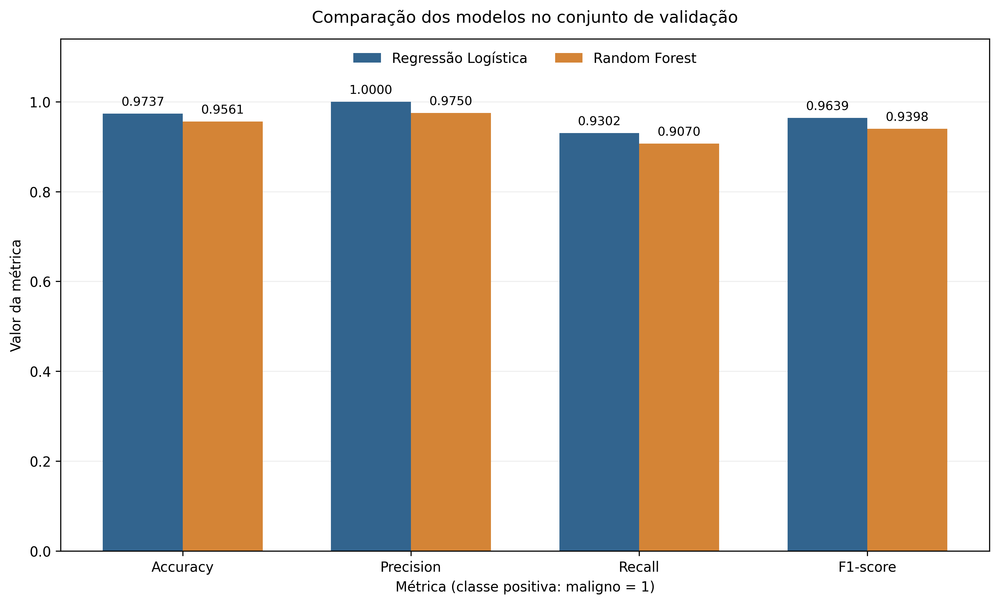
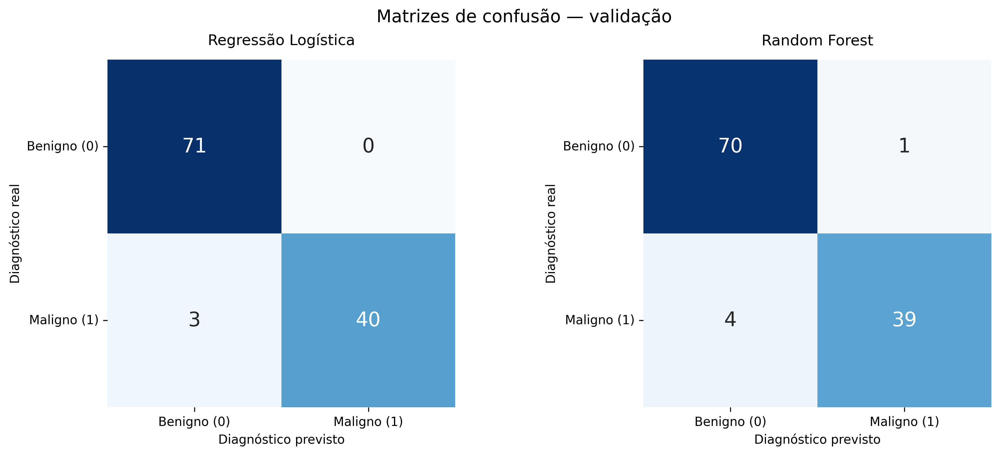
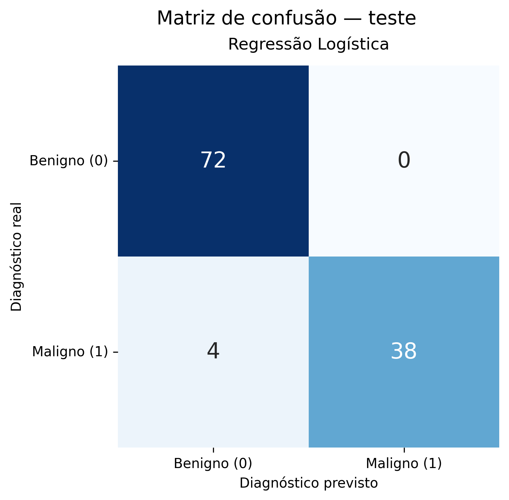
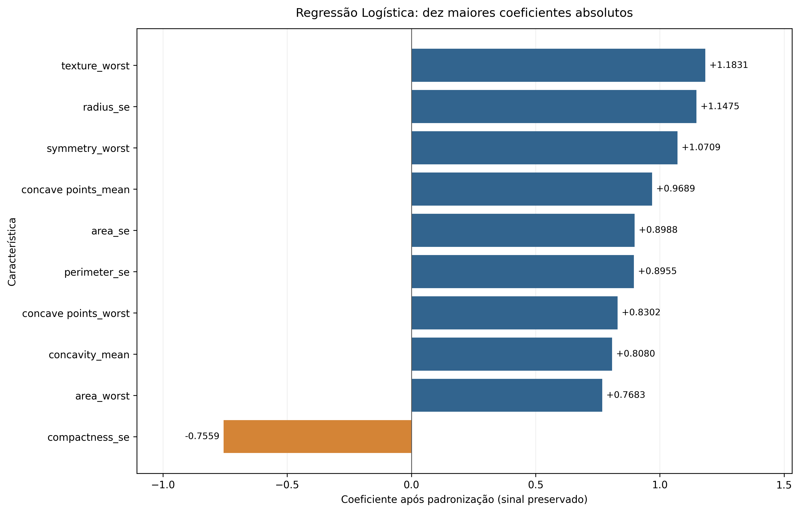
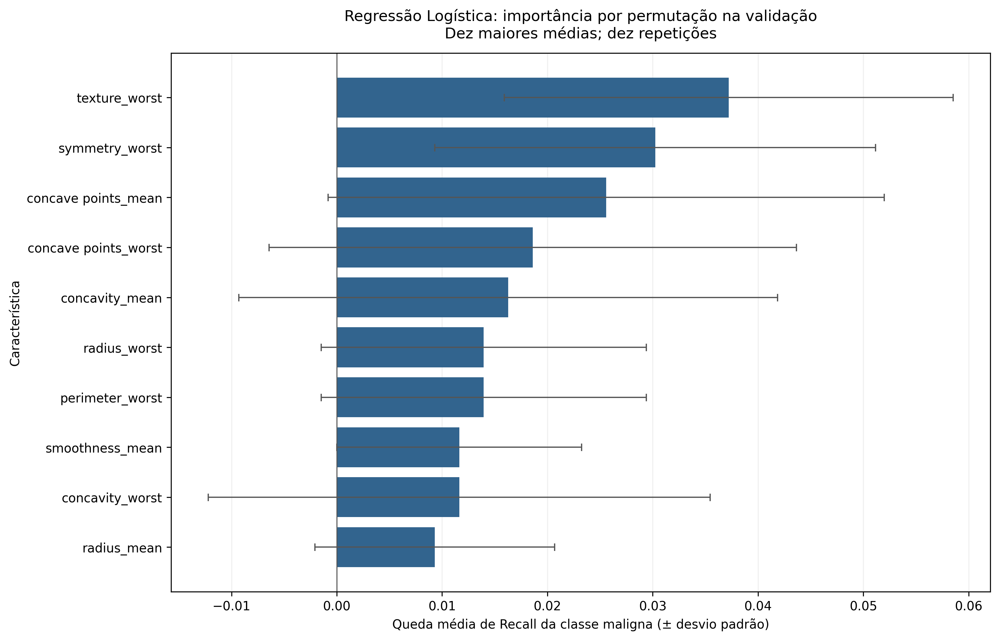

# Classificação de câncer de mama com Machine Learning

**Relatório técnico acadêmico — Tech Challenge, Fase 1**

- **Instituição:** FIAP
- **Autor:** Caio Locoselli
- **RM:** 378059

## 1. Introdução e objetivo

A classificação de dados médicos permite investigar relações entre características observadas e diagnósticos registrados. Neste projeto acadêmico, técnicas de Machine Learning foram utilizadas para classificar amostras do dataset Breast Cancer Wisconsin Diagnostic como benignas ou malignas.

O objetivo foi desenvolver um fluxo reproduzível de análise exploratória, preparação dos dados, treinamento e comparação de dois classificadores: Regressão Logística e Random Forest. Após a comparação na validação, a Regressão Logística foi selecionada para avaliação final no teste e análise de interpretabilidade.

O trabalho tem finalidade educacional. O modelo não constitui uma ferramenta de diagnóstico clínico, e os resultados não substituem a avaliação médica. A descrição metodológica se apoia no código e nas análises do repositório [1–5]; as figuras são os arquivos já disponíveis em `results/` [6].

## 2. Descrição do dataset Breast Cancer Wisconsin Diagnostic

O dataset utilizado está disponível no Kaggle, na página indicada no README do projeto [1, 7]. O arquivo local esperado é `data/raw/data.csv`. O CSV original é mantido fora do versionamento e não é alterado pelos módulos de análise.

A base carregada no notebook possui **569 registros e 33 colunas**: 30 características numéricas, a variável alvo `diagnosis`, o identificador `id` e a coluna `Unnamed: 32`. As medidas incluem raio, textura, perímetro, área, suavidade, compacidade, concavidade, pontos côncavos, simetria e dimensão fractal, organizadas pelos sufixos `mean`, `se` e `worst`.

O diagnóstico foi codificado como **B = 0, benigno**, e **M = 1, maligno**. A análise exploratória registrou 357 casos benignos, correspondentes a 62,74% da base, e 212 malignos, correspondentes a 37,26%. Essa diferença de representação das classes justifica examinar métricas específicas para os casos malignos, além da proporção global de acertos.

## 3. Análise exploratória dos dados

A exploração está documentada em [notebooks/exploratory_analysis.ipynb](../notebooks/exploratory_analysis.ipynb) [2]. Foram examinadas a estrutura da base, as estatísticas descritivas, os valores ausentes, as duplicidades, a distribuição dos diagnósticos e as relações entre características.

### 3.1. Qualidade e estrutura

A coluna `Unnamed: 32` apresentou 569 valores ausentes, abrangendo todos os registros. As demais colunas não apresentaram valores ausentes nas verificações realizadas. Não foram encontradas linhas integralmente duplicadas; essa verificação não demonstra, por si só, a inexistência de múltiplos registros de uma mesma pessoa.

As estatísticas descritivas evidenciaram diferenças de escala entre as medidas. Por exemplo, `radius_mean` variou de 6,981 a 28,11, enquanto `area_mean` variou de 143,5 a 2.501,0. Esses resultados contextualizam a escolha da padronização no pipeline de treinamento.

### 3.2. Distribuições e valores extremos

O histograma de `radius_mean` indicou maior concentração dos casos benignos em valores menores e tendência a valores maiores entre os malignos. A sobreposição das distribuições mostra que essa característica isolada não separa perfeitamente as classes.

O boxplot de `area_mean` mostrou mediana e dispersão maiores no grupo maligno. Foram observados possíveis outliers nos dois grupos, sem evidência suficiente para classificá-los como erros de registro. Não foi implementada exclusão ou correção desses valores.

Essas duas características foram escolhidas para a exploração inicial por representarem medidas de tamanho de interpretação direta. A escolha não decorreu de uma importância preditiva previamente demonstrada.

### 3.3. Correlações

Com o diagnóstico representado como B = 0 e M = 1, as maiores correlações de Pearson exibidas com o alvo foram de `concave points_worst`, aproximadamente 0,794, e `perimeter_worst`, aproximadamente 0,783.

O mapa de calor também mostrou correlações positivas elevadas entre medidas de raio, perímetro e área. A associação entre `radius_mean` e `perimeter_mean` foi exibida como 1,00 após arredondamento a duas casas decimais, sem implicar igualdade exata entre as medidas. Essas relações sugerem possível redundância, mas não demonstram causalidade nem justificaram a exclusão automática de características.

## 4. Estratégias de pré-processamento

O módulo [src/data_preparation.py](../src/data_preparation.py) [3] concentra o carregamento, a validação do esquema, a organização das características e a divisão dos conjuntos.

Antes da conversão do alvo, o código verifica as colunas necessárias e rejeita diagnósticos diferentes de B ou M, inclusive ausentes. Também verifica se as características selecionadas possuem tipos numéricos. São utilizadas as 30 características esperadas, excluindo `id`, `Unnamed: 32` e o próprio diagnóstico do conjunto de preditores.

Cada classificador utiliza um pipeline independente com duas transformações:

1. **Imputação pela mediana:** `SimpleImputer(strategy="median")`, para eventuais valores numéricos ausentes. Embora a exploração não tenha encontrado ausências nas características utilizadas, essa etapa integra o fluxo reutilizável.
2. **Padronização:** `StandardScaler`, para colocar as características em escalas comparáveis. A Random Forest recebe a mesma preparação para manter um fluxo consistente entre os modelos.

Os pipelines são criados sem ajuste prévio. Medianas e parâmetros de padronização são estimados exclusivamente no treinamento; validação e teste recebem as transformações do pipeline já ajustado. Não há normalização das bases completas antes da divisão, tratamento de características categóricas ou seleção de variáveis. Todas as 30 características numéricas são mantidas.

## 5. Metodologia de treinamento e validação

A separação utiliza `train_test_split`, com estratificação pelo diagnóstico e `random_state=42` nas duas etapas. Primeiro são separados o treinamento e os registros restantes; depois, estes são divididos igualmente entre validação e teste.

| Conjunto | Proporção prevista | Quantidade de registros | Finalidade |
|---|---:|---:|---|
| Treinamento | 60% | 341 | Ajuste do pré-processamento e dos classificadores |
| Validação | 20% | 114 | Comparação dos modelos e importância por permutação |
| Teste | 20% | 114 | Avaliação final do modelo previamente selecionado |

As quantidades refletem o arredondamento para registros inteiros. Os índices originais são preservados, permitindo verificar que não há sobreposição entre os conjuntos.

A divisão estratificada de 60% para treinamento, 20% para validação e 20% para teste foi adotada para permitir a comparação dos classificadores e preservar um conjunto separado para a avaliação final. Essa distribuição oferece uma quantidade razoável de registros para cada etapa, mas também limita o número de exemplos disponíveis para o aprendizado, especialmente os casos malignos. Não foram comparadas diferentes proporções de divisão, portanto não é possível afirmar que essa configuração seja a ideal. Uma base maior e avaliações adicionais poderiam fornecer estimativas de desempenho mais robustas.

O módulo [src/model_training.py](../src/model_training.py) [4] integra pré-processamento e classificador com `Pipeline`. As configurações explícitas são:

| Classificador | Configuração |
|---|---|
| Regressão Logística | `max_iter=1000`, `random_state=42` |
| Random Forest | `n_estimators=200`, `random_state=42` |

Os demais parâmetros permanecem nos valores padrão da implementação utilizada. Não houve otimização de hiperparâmetros. A Regressão Logística fornece uma referência linear para classificação binária e permite interpretar coeficientes. A Random Forest oferece uma comparação com um conjunto de árvores capaz de representar relações não lineares.

Foram utilizadas Accuracy, Precision, Recall, F1-score e matriz de confusão. Accuracy resume os acertos globais. Precision expressa a proporção de casos realmente malignos entre as previsões malignas; Recall expressa a proporção de malignos identificados; F1-score combina Precision e Recall pela média harmônica. As métricas binárias utilizam **maligno = 1** como classe positiva.

A configuração e a escolha do modelo foram definidas a partir da validação. Os resultados de teste não foram usados para reconsiderar a escolha, ajustar hiperparâmetros ou estimar a importância por permutação.

## 6. Comparação entre Regressão Logística e Random Forest

Os dois modelos foram ajustados no treinamento e avaliados nos mesmos 114 registros de validação. Os resultados apresentados no README e na Figura 1 são:

| Modelo | Accuracy | Precision | Recall | F1-score |
|---|---:|---:|---:|---:|
| Regressão Logística | 0,9737 | 1,0000 | 0,9302 | 0,9639 |
| Random Forest | 0,9561 | 0,9750 | 0,9070 | 0,9398 |

*Figura 1 — Comparação dos classificadores no conjunto de validação. Fonte: resultados do projeto [6].*

A Regressão Logística apresentou valores superiores nas quatro métricas nesta divisão. O Recall da classe maligna, de 0,9302 frente a 0,9070 da Random Forest, teve destaque na seleção, pois permite observar os casos malignos não identificados.

As matrizes de validação ajudam a contextualizar essa diferença: a Regressão Logística apresentou três falsos negativos e nenhum falso positivo; a Random Forest apresentou quatro falsos negativos e um falso positivo. Esses resultados sustentam a escolha inicial da Regressão Logística no experimento, sem estabelecer superioridade geral entre os algoritmos.

*Figura 2 — Matrizes de validação, com classes benigno (0) e maligno (1). As linhas representam os diagnósticos reais e as colunas, os previstos. Fonte: resultados do projeto [6].*

## 7. Avaliação final da Regressão Logística

A avaliação final utiliza [src/model_evaluation.py](../src/model_evaluation.py) [5]. A Regressão Logística previamente selecionada foi ajustada exclusivamente nos **341 registros de treinamento**, com a configuração já utilizada. Não houve ajuste adicional com os registros de validação ou teste. A Random Forest não foi avaliada no teste.

Nos **114 registros de teste**, foram obtidos:

| Accuracy | Precision | Recall | F1-score |
|---:|---:|---:|---:|
| 0,9649 | 1,0000 | 0,9048 | 0,9500 |

A matriz de confusão foi **`[[72, 0], [4, 38]]`**, na ordem `[[VN, FP], [FN, VP]]`, com classes [0, 1]:

| Diagnóstico real | Previsto benigno (0) | Previsto maligno (1) |
|---|---:|---:|
| Benigno (0) | 72 — verdadeiros negativos | 0 — falsos positivos |
| Maligno (1) | 4 — falsos negativos | 38 — verdadeiros positivos |

*Figura 3 — Avaliação final da Regressão Logística no teste. Os quatro falsos negativos aparecem na célula de casos reais malignos previstos como benignos. Fonte: resultados do projeto [6].*

### Implicações dos quatro falsos negativos

Os quatro falsos negativos correspondem a registros cujo diagnóstico era maligno, mas que receberam previsão benigna. A Precision de 1,0000 indica ausência de falsos positivos nessa amostra; ela não significa que todos os casos malignos foram encontrados. Essa limitação aparece no Recall de 0,9048.

Em um eventual contexto de apoio à análise médica, uma previsão benigna incorreta poderia produzir falsa segurança e deixar de sinalizar a necessidade de investigação, caso fosse utilizada isoladamente. Esse é um risco potencial associado ao tipo de erro, e não um desfecho assistencial observado no experimento. O projeto não avaliou decisões médicas, atrasos de diagnóstico ou efeitos sobre pacientes.

Por isso, os resultados globais de acerto devem ser examinados junto aos falsos negativos. Os dados disponíveis não permitem concluir que o modelo seja seguro para uso clínico ou substituir a avaliação de profissionais de saúde.

## 8. Interpretabilidade das características

A interpretabilidade utiliza o mesmo pipeline treinado da Regressão Logística [5]. Foram examinados os coeficientes após padronização e a importância por permutação na validação. Os nomes das características são preservados e conferidos em relação à saída do pré-processamento.

### 8.1. Coeficientes após padronização

A Figura 4 apresenta as dez características com maiores coeficientes absolutos, mantendo os sinais. Entre elas, `texture_worst`, `radius_se` e `symmetry_worst` apresentam as maiores magnitudes. `compactness_se` aparece com coeficiente negativo.

Um coeficiente positivo aumenta a pontuação estimada, em log-odds, para a classe maligna quando a característica aumenta, mantidas as demais constantes. Um coeficiente negativo reduz essa pontuação nas mesmas condições. Como as medidas foram padronizadas, a interpretação considera a escala resultante do pipeline ajustado no treinamento.

*Figura 4 — Coeficientes padronizados da Regressão Logística. A ordenação considera a magnitude, enquanto a direção das barras preserva o sinal. Fonte: resultados do projeto [6].*

### 8.2. Importância por permutação na validação

A importância por permutação foi calculada exclusivamente nos **114 registros de validação**, com Recall da classe maligna, `random_state=42` e `n_repeats=10`. O pipeline não é reajustado durante essa análise. A medida representa a queda média de Recall quando os valores de uma característica são embaralhados.

Na Figura 5, `texture_worst`, `symmetry_worst` e `concave points_mean` apresentam as maiores importâncias médias. As barras de erro mostram o desvio padrão entre as repetições, indicando a variabilidade da medida. Essas barras não representam intervalos de confiança.

*Figura 5 — Dez maiores importâncias médias por permutação na validação. As barras de erro representam o desvio padrão das dez repetições. Fonte: resultados do projeto [6].*

As duas técnicas respondem a perguntas diferentes: os coeficientes descrevem a contribuição de cada característica na função estimada, enquanto a permutação examina a alteração do desempenho ao embaralhar seus valores. Características correlacionadas podem compartilhar informação, dificultar a interpretação individual dos coeficientes e reduzir a importância observada por permutação. Nenhuma dessas associações deve ser tratada como relação causal.

## 9. Discussão crítica e limitações

Os resultados mostram que a Regressão Logística teve melhor desempenho na comparação de validação realizada. No teste, entretanto, permaneceram quatro casos malignos classificados como benignos. A combinação de Precision elevada e Recall inferior evidencia que uma única métrica não descreve adequadamente todos os erros de classificação.

A base contém relativamente poucos registros e a avaliação utiliza uma única divisão estratificada. Não foram realizadas validação cruzada, avaliação externa ou estimativas de incerteza das métricas. Assim, as diferenças observadas entre os classificadores não demonstram significância estatística nem garantem o mesmo desempenho em outras amostras.

O notebook exploratório examina a base completa, inclusive por diagnóstico. Embora o ajuste dos pipelines e a seleção do classificador respeitem as divisões implementadas, o teste não foi completamente desconhecido durante a exploração descritiva. Essa exposição deve ser considerada ao interpretar a independência do processo de avaliação. As 30 características foram mantidas, sem seleção automática baseada nas correlações exploratórias.

O compartilhamento de informação entre características correlacionadas também limita as conclusões sobre importância individual. Coeficientes elevados ou quedas de Recall na permutação não identificam mecanismos biológicos nem explicam, isoladamente, os motivos dos quatro falsos negativos. O projeto não realizou uma investigação individual desses erros.

A reprodutibilidade é apoiada por divisões e modelos com estados aleatórios definidos, versões de dependências declaradas e testes automatizados. O README registra a aprovação dos 26 testes e a execução dos módulos em Docker com o dataset montado somente para leitura. Essas verificações apoiam a consistência da implementação, mas não constituem evidência de validade clínica.

O estudo não avaliou aplicação prospectiva, integração com decisões assistenciais ou desempenho em outras populações. Portanto, suas conclusões se restringem ao experimento acadêmico documentado.

## 10. Conclusão e referências

### 10.1. Conclusão

O projeto implementou um fluxo reproduzível de classificação binária, desde a exploração e validação dos dados até a avaliação final e a interpretação do modelo. A comparação na validação favoreceu a Regressão Logística, selecionada antes da avaliação no teste, especialmente pelo maior Recall da classe maligna.

Na avaliação final, o modelo obteve Accuracy de 0,9649, Precision de 1,0000, Recall de 0,9048 e F1-score de 0,9500. Os quatro falsos negativos demonstram uma limitação relevante, apesar da ausência de falsos positivos nessa amostra. A análise de coeficientes e permutação permitiu examinar características utilizadas pelo modelo, com ressalvas quanto à correlação e à ausência de interpretação causal.

Os resultados atendem ao objetivo acadêmico de comparar classificadores e discutir seus erros e limitações. Eles não sustentam uso diagnóstico autônomo nem substituem avaliação médica ou validação clínica.

### 10.2. Referências

As referências abaixo identificam as fontes efetivamente utilizadas nesta versão: a documentação e os artefatos do projeto, além da página do dataset indicada no README.

1. **Documentação do projeto.** [README.md](../README.md). Descrição do dataset, metodologia, resultados e execução local e por Docker.
2. **Análise exploratória do projeto.** [exploratory_analysis.ipynb](../notebooks/exploratory_analysis.ipynb). Estatísticas descritivas, qualidade dos dados, distribuições e correlações.
3. **Preparação dos dados.** [data_preparation.py](../src/data_preparation.py). Carregamento, validação, divisão estratificada e pipeline de pré-processamento.
4. **Treinamento e comparação dos classificadores.** [model_training.py](../src/model_training.py). Configurações dos modelos e cálculo das métricas.
5. **Avaliação final e interpretabilidade.** [model_evaluation.py](../src/model_evaluation.py). Avaliação da Regressão Logística e análises de importância.
6. **Resultados visuais do projeto.** [Diretório results/](../results/). Gráficos existentes de validação, teste, coeficientes e permutação.
7. **Kaggle.** [Breast Cancer Wisconsin (Diagnostic) Data Set](https://www.kaggle.com/datasets/uciml/breast-cancer-wisconsin-data/data). Página de disponibilização do dataset indicada na documentação do projeto.
